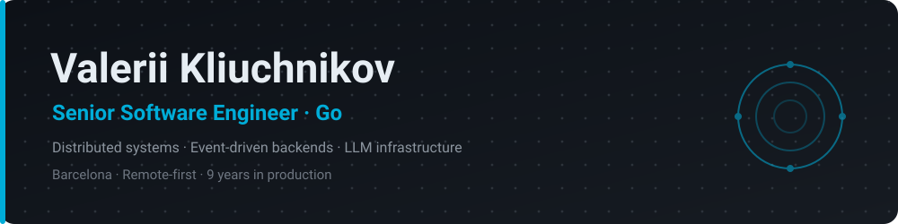

  <picture>
    <source media="(prefers-color-scheme: dark)" srcset="assets/banner-dark.svg">
    <source media="(prefers-color-scheme: light)" srcset="assets/banner-light.svg">
    
  </picture>

  
  
  

---

I build **production backend systems in Go** — 9 years across fintech, AI tooling, and social platforms. Based in Barcelona.

- 🛠 **Currently** Senior Software Engineer at [Playneta](https://playneta.gg): backend services in a Go microservices monorepo — LLM-powered chat translation, UGC moderation, and a shared Kafka DLQ layer.
- 🏛 **Previously** enterprise RBAC and payment systems, MCP server integrations at [Refact.ai](https://refact.ai), Hyperledger Fabric smart contracts, and GDPR / PCI DSS tokenization services.
- 🧭 **Into** distributed systems design, LLM infrastructure and cost control, event-driven architectures, high-throughput services, and reliability primitives (DLQ, graceful degradation, observability).
- 📬 **Open to** a long-term full-time backend role, EU or North America, remote-first — [kliuchnikovv@icloud.com](mailto:kliuchnikovv@icloud.com).

### Tech

### Selected projects

| Project | What it is |
|---------|-----------|
| **[engi](https://github.com/kliuchnikovv/engi)** | Lightweight Go HTTP framework — declarative routing, automatic parameter validation, auth/CORS middleware, OpenTelemetry tracing, auto-generated OpenAPI docs and graceful shutdown. |
| **[nomi](https://github.com/kliuchnikovv/nomi)** | AI-agent ecosystem — Go API gateway + Python (Agno) agent orchestration + a React Native app, with a plugin system and real-time WebSocket streaming. |
| **[keystone](https://github.com/kliuchnikovv/keystone)** | Local-first smart-home hub that reimplements the core of Home Assistant on bare **ESP32** (C++ / ESP-IDF), across several chips in one enclosure — plus a Go remote-access relay and an Expo app. |
| **[dnd](https://github.com/kliuchnikovv/dnd)** | A **mobile** detective RPG where a **deterministic Go rules engine** decides what is true and language models only narrate. Reproducible from `(seed, input)`; 1200+ tests, 10 ADRs. |

### Off the clock

ESP32 microelectronics · 3D printing · RC aircraft · agentic tooling built with Claude Code

---

  
  
  

